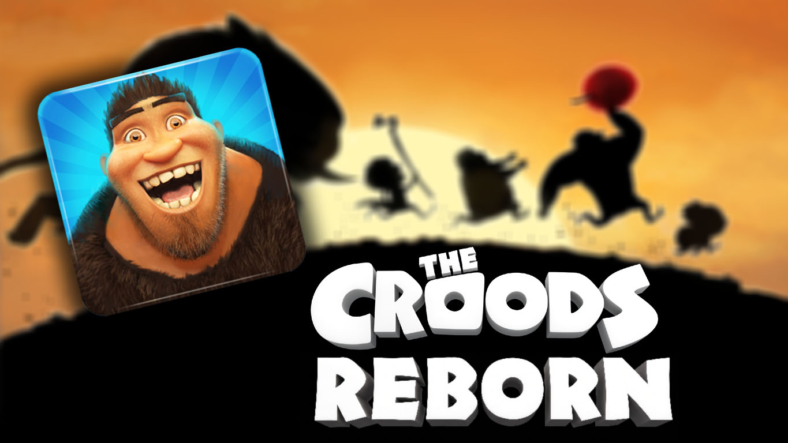

# Croods Reborn

**English** | [Polski](README.pl.md)

**Croods Reborn** is a preservation and reverse-engineering project aimed at reviving the 2013 mobile game *The Croods*. Because the official backend servers were shut down, the original client gets stuck on the startup connection screen. This repository provides a local server emulator and asset analysis utilities.

## Repository Structure

* **`scripts/croods_server_emulator.py`** — A lightweight local server that emulates the official Rovio Cloud API. It handles startup requests from the game client (server time synchronization, cloud save state/load endpoints, and required asset checks), allowing the unmodified game to pass the startup block and boot properly.
* **`scripts/massive_decrypt.py`** — A batch processing utility that recursively traverses original game directories, decrypts encrypted script containers, extracts the underlying `.7z` archives, and decompiles Lua 5.1 bytecode (`LuaQ`) into readable `.lua` files while preserving the original folder hierarchy.
* **`scripts/single_decrypt.py`** — A simple helper script that reads `input.lua` from the same folder and decrypts it directly into `out.7z` for manual inspection.

## Decryption Keys (AES-256-CBC)

Two 256-bit AES keys were extracted from the game binary (used with `AES-CBC` mode and a zeroed 16-byte IV `0x00 * 16`):

* **Key 1 (Primary):** `5354636f51776b61544679707449394639436f53704846786d336a5457716865`  
  Used across the game's script and asset loading routines (`gamelua` / `.7z` script archives).
* **Key 2 (Secondary):** `3434695559356154726c61596f6574396c6170526c614b3145686c6563356930`  
  Also present in the binary's resource loader structure, though its exact usage in the game has not been identified yet.

## Getting Started

### Prerequisites
* Python 3.10+
* `pycryptodome` (for decryption utilities):
  ```bash
  pip install pycryptodome
  ```
* `p7zip` (`7z` CLI) and Java + `unluac.jar` (optional, for automated archive extraction and Lua decompilation in `massive_decrypt.py`).

### 1. Running the Server Emulator
Start the local cloud API emulator on your host machine:
```bash
python3 scripts/croods_server_emulator.py
```
Configure your device or emulator's network proxy / DNS settings to route the game's API traffic to your host machine's local IP address and port.

### 2. Decrypting Game Files

* **Single file (`scripts/single_decrypt.py`):**  
  Place an encrypted script file named `input.lua` in the `scripts/` folder and run:
  ```bash
  python3 scripts/single_decrypt.py
  ```
  The decrypted archive will be saved as `out.7z` in the same folder.

* **Batch unpack & decompile (`scripts/massive_decrypt.py`):**
  ```bash
  python3 scripts/massive_decrypt.py path/to/game_files output_dir/
  ```

## Disclaimer
This project is intended strictly for educational, interoperability, and software preservation purposes. **No copyrighted game binaries, proprietary assets, or decrypted game scripts are hosted in this repository.** You must supply your own legally obtained copy of the game files. This project is not affiliated with, endorsed by, or connected to Rovio Entertainment or DreamWorks Animation.
