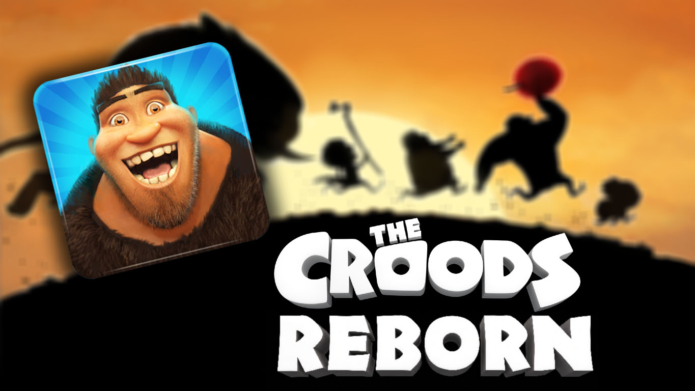

# Croods Reborn

[English](README.md) | **Polski**

**Croods Reborn** to projekt archiwizacyjny oraz z zakresu inżynierii wstecznej, którego celem jest przywrócenie do działania gry mobilnej *The Croods* z 2013 roku. Po wyłączeniu oficjalnych serwerów oryginalny klient zatrzymuje się na ekranie sprawdzania połączenia przy starcie. Repozytorium zawiera lokalny emulator serwera oraz narzędzia pomocnicze pozwalające na odczyt skryptów.

## Struktura repozytorium

* **`scripts/croods_server_emulator.py`** — Lokalny serwer emulujący oficjalne API chmurowe Rovio. Odpowiada na żądania wysyłane przez grę podczas uruchamiania (synchronizacja czasu serwera, obsługa zapisów w chmurze oraz weryfikacja wymaganych zasobów), co odblokowuje ekran ładowania i pozwala uruchomić grę.
* **`scripts/massive_decrypt.py`** — Skrypt do masowego przetwarzania plików gry. Rekurencyjnie przeszukuje katalogi z oryginalnymi plikami, odszyfrowuje zaszyfrowane kontenery, wypakowuje archiwa `.7z` i dekompiluje bajtkod Lua 5.1 (`LuaQ`) do czytelnych skryptów `.lua` z zachowaniem oryginalnej struktury folderów.
* **`scripts/single_decrypt.py`** — Proste narzędzie, które pobiera plik `input.lua` z tego samego folderu i zapisuje jego odszyfrowaną zawartość jako archiwum `out.7z`.

## Klucze deszyfrujące (AES-256-CBC)

Z pliku binarnego gry wydobyto dwa 256-bitowe klucze AES (używane w trybie `AES-CBC` z zerowym 16-bajtowym wektorem inicjalizującym `0x00 * 16`):

* **Key 1 (Główny):** `5354636f51776b61544679707449394639436f53704846786d336a5457716865`  
  Główny klucz wykorzystywany przez grę do odszyfrowywania archiwów ze skryptami Lua oraz zasobów (`gamelua` / paczki `.7z`).
* **Key 2 (Dodatkowy):** `3434695559356154726c61596f6574396c6170526c614b3145686c6563356930`  
  Drugi klucz obecny w kodzie ładowania zasobów binarki, jednak jego dokładne zastosowanie w grze nie zostało jeszcze ustalone.

## Uruchomienie

### Wymagania
* Python 3.10+
* Biblioteka `pycryptodome` (wymagana przez skrypty deszyfrujące):
  ```bash
  pip install pycryptodome
  ```
* Pakiet `p7zip` (`7z`) oraz Java + `unluac.jar` (opcjonalnie, do automatycznego wypakowywania i dekompilacji Lua w `massive_decrypt.py`).

### 1. Uruchomienie emulatora serwera
Uruchom lokalny emulator API na swoim komputerze:
```bash
python3 scripts/croods_server_emulator.py
```
Następnie przekieruj ruch sieciowy z urządzenia lub emulatora (poprzez ustawienia proxy Wi-Fi lub lokalny DNS) na adres IP i port maszyny, na której działa skrypt.

### 2. Odszyfrowywanie plików gry

* **Pojedynczy plik (`scripts/single_decrypt.py`):**  
  Umieść zaszyfrowany plik pod nazwą `input.lua` w tym samym folderze co skrypt (`scripts/`) i uruchom:
  ```bash
  python3 scripts/single_decrypt.py
  ```
  Odszyfrowane archiwum zostanie zapisane jako `out.7z` w tym samym katalogu.

* **Masowe odszyfrowanie i dekompilacja (`scripts/massive_decrypt.py`):**
  ```bash
  python3 scripts/massive_decrypt.py sciezka/do/plikow_gry katalog_wyjsciowy/
  ```

## Zastrzeżenia prawne
Projekt ma charakter wyłącznie edukacyjny i archiwizacyjny. **Repozytorium nie zawiera żadnych plików wykonywalnych gry, zasobów graficznych/dźwiękowych ani odszyfrowanych skryptów.** Do korzystania z narzędzi wymagane jest posiadanie własnej kopii plików gry. Projekt nie jest powiązany z firmami Rovio Entertainment ani DreamWorks Animation.
